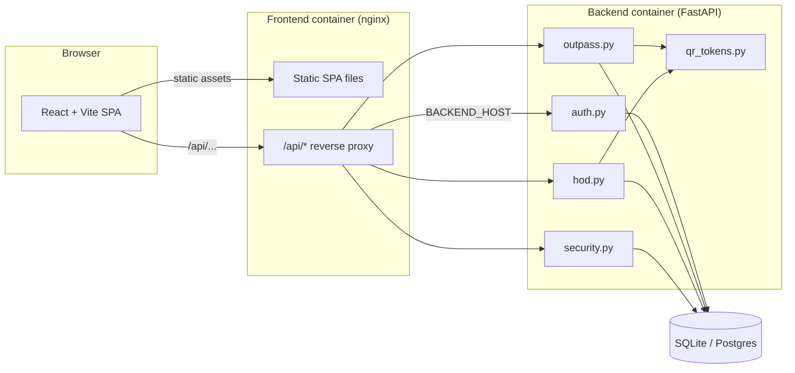

# CampusPass

A digital campus outpass and exit management system: students request an
exit, a teacher then the HOD both have to approve it, and the resulting
exit credential (a signed, time-limited QR code — or a 6-character code as
a fallback when scanning isn't reliable) is checked by security at the gate,
single-use.

**New to this project? Start with [`instructions.md`](instructions.md)** —
a beginner-friendly, copy-paste walkthrough covering setup, accounts,
every way to run the app, a full test checklist, and troubleshooting. The
rest of this README is the shorter technical reference.

## Architecture



See [`docs/architecture.md`](docs/architecture.md) for the full component
breakdown, data model, and the QR/short-code security properties
(authenticity, freshness, single-use).

## Roles and the outpass workflow

| Role | Does |
|---|---|
| **Student** | Submits an outpass request (reason + exit time). Views status, the QR code and short exit code once fully approved. |
| **Teacher** | First approval stage. Approves or rejects pending requests. Approving does **not** generate the exit credential — it sends the request to the HOD. |
| **HOD** | Second and final approval stage. Approving here is what actually generates the QR token + short code. Also has full admin visibility (every outpass regardless of status, every user, every exit log) and can create/deactivate user accounts. |
| **Security** | At the gate, enters either the scanned QR token or the short code into one field — both are checked identically. A successful check marks the exit as used; a repeat attempt with the same credential is rejected. |

```
pending --(teacher approves)--> teacher_approved --(HOD approves)--> approved (QR + code live)
   |                                    |
   +--(teacher rejects)--> rejected <---+--(HOD rejects)
```

## Project structure

```
app/                 FastAPI backend
  main.py             app entrypoint, CORS, table creation on startup
  models.py           SQLAlchemy models (User, Outpass, ExitLog)
  schemas.py           Pydantic schemas + request validators
  database.py          DB session/engine setup (SQLite or Postgres via DATABASE_URL)
  auth.py              password hashing, JWT, role-gating dependency
  qr_tokens.py          QR JWT + short-code generation/verification
  routers/              auth.py, outpass.py, hod.py, security.py
scripts/
  seed.py               creates the real accounts (+ optional --demo accounts)
tests/                  pytest suite (78 tests)
frontend/               React (Vite) + Tailwind SPA
  src/utils/__tests__/   Vitest unit tests
  Dockerfile              multi-stage: Vite build -> nginx serve
  nginx.conf.template     SPA routing + /api reverse proxy (runtime-configured)
Dockerfile              backend image (multi-stage, non-root, HEALTHCHECK)
docker-compose.yml       backend + frontend together, persistent volume
k8s/                    Kubernetes manifests (namespace, Deployments, Services, PVC, Secret, ConfigMap)
ansible/                playbook + roles: install Docker/kubectl/minikube, deploy, verify
Jenkinsfile             declarative pipeline: test -> build -> push -> deploy
.github/workflows/      GitHub Actions: test + docker build on push/PR, Render deploy trigger on main
render.yaml             Render Blueprint (Postgres + both services)
docs/                   architecture.md, devops.md, demo-script.md
```

## Quickest start: Docker Compose

No local Python/Node install needed:

```bash
docker compose up --build
```

- Frontend: http://localhost:5173
- Backend: http://localhost:8000 (health check at `/health`)

Seed the real accounts (admin, teacher, student, security1) inside the
running backend container:

```bash
docker compose exec backend python -m scripts.seed
docker compose cp backend:/code/CREDENTIALS.md ./CREDENTIALS.md
```

Then log in at http://localhost:5173/login using an email/username from
the table below, with the password from the now-local `CREDENTIALS.md`
(gitignored — generated fresh per machine, never committed).

| Role | Email / username | Password |
|---|---|---|
| Admin (HOD) | rohan.pagadala15@gmail.com | see `CREDENTIALS.md` |
| Teacher | patlollamandeepreddy3183@gmail.com | see `CREDENTIALS.md` |
| Student | rithvikreddy27@gmail.com | see `CREDENTIALS.md` |
| Security | `security1` | see `CREDENTIALS.md` |

Login accepts either the email (case-insensitive) or the username. Want
the old `student1`/`teacher1`/`hod1` demo accounts (local only,
`password123`) too? `docker compose exec backend python -m scripts.seed
--demo`. See [`instructions.md`](instructions.md) for the full accounts
walkthrough, including changing/resetting a password.

**Data persistence:** the SQLite file lives in a named Docker volume
(`backend_data`), not the container's writable layer, so it survives
`docker compose down` / `up` and restarts. Remove it to start fresh:
`docker compose down -v`.

**Config:** copy `.env.example` to `.env` to override `SECRET_KEY`,
`BACKEND_PORT`, `FRONTEND_PORT`, `CORS_ORIGINS` — `docker compose` loads
`.env` automatically. If `8000`/`5173` are already taken, set
`BACKEND_PORT`/`FRONTEND_PORT` to something else (the frontend's `/api`
proxy always reaches the backend over the Docker network, regardless of
which host port it's published on).

To stop: `docker compose down` (add `-v` to also delete persisted data).

## Frontend visual reference

The frontend uses an offline Inter font, the CBIT mark, a responsive indigo/lavender
workspace shell, and reusable status-aware cards and controls. A few checked-in
captures from the redesign are available here:

- [Login — desktop](docs/screenshots/login-1440.png)
- [Login — mobile](docs/screenshots/login-390.png)
- [Student dashboard — desktop](docs/screenshots/student-dashboard-1440.png)

## Run locally without Docker

**Backend:**

```bash
python -m venv .venv
source .venv/bin/activate
pip install -r requirements.txt
uvicorn app.main:app --reload
python -m scripts.seed   # creates the real accounts, writes CREDENTIALS.md
```

**Frontend** (separate terminal):

```bash
cd frontend
npm install
npm run dev
```

Vite's dev server proxies `/api/*` to `http://localhost:8000` (see
`frontend/vite.config.js`), matching the Docker/K8s nginx proxy behavior —
the frontend code never needs to know the backend's address either way.

## Running the tests

**Backend** (78 tests — auth incl. email login/case-insensitivity,
change-password, role gating, the full dual-approval lifecycle, QR token
round-trip/tamper/expiry, scan success/already-used/not-approved, HOD admin
endpoints incl. duplicate-email rejection and self-deactivation guard, seed
script behavior incl. the `--demo` production guard):

```bash
pip install -r requirements-dev.txt
pytest tests/ -v
```

**Frontend** (Vitest unit tests for the error-message and JWT-decoding
utilities):

```bash
cd frontend
npm run test
npm run build   # production build must also succeed
```

## Kubernetes (Minikube)

```bash
minikube start --driver=docker
docker build -t campuspass-backend:latest .
docker build -t campuspass-frontend:latest ./frontend
minikube image load campuspass-backend:latest
minikube image load campuspass-frontend:latest
kubectl apply -f k8s/
kubectl set image deployment/campuspass-backend campuspass-backend=campuspass-backend:latest -n campuspass
kubectl set image deployment/campuspass-frontend campuspass-frontend=campuspass-frontend:latest -n campuspass
kubectl rollout status deployment/campuspass-backend -n campuspass
kubectl rollout status deployment/campuspass-frontend -n campuspass
kubectl exec -n campuspass deploy/campuspass-backend -- python -m scripts.seed
kubectl port-forward -n campuspass svc/campuspass-frontend 30080:80
```

Seeding here creates the real accounts (never the `--demo` ones — the
cluster's ConfigMap sets `ENVIRONMENT=production`, which the seed script's
`--demo` flag refuses to run under anyway). Copy the printed passwords from
that `kubectl exec` output.

Then open http://localhost:30080. (`minikube service campuspass-frontend -n
campuspass --url` also works, but blocks in the foreground on macOS with
the docker driver — `port-forward` is simpler for a one-off check.)

For a real multi-node cluster, replace the `DOCKERHUB_USERNAME` placeholder
in `k8s/04-backend-deployment.yaml` and `k8s/06-frontend-deployment.yaml`
with a real Docker Hub namespace, push the images there, and skip the
`minikube image load` / `kubectl set image` steps — `kubectl apply -f k8s/`
alone is then enough. Also replace the placeholder value in
`k8s/02-secret.yaml` — see that file's comments for the one-line
`kubectl create secret` command that generates a real key without ever
touching git.

## Ansible (fresh Ubuntu machine)

```bash
cd ansible
ansible-galaxy collection install -r requirements.yml
ansible-playbook --syntax-check playbook.yml   # validate first
ansible-playbook -i inventory/hosts.ini playbook.yml
```

Installs Docker, installs `kubectl`/`minikube`, clones this repo, builds
both images, starts minikube, applies the K8s manifests, seeds the real
accounts, and polls `/api/health` until the app actually responds. Every
step is idempotent — re-running after a partial failure doesn't redo
completed work. Edit `repo_url` in `ansible/playbook.yml` to point at your
fork, and `ansible/inventory/hosts.ini` to point at the real target host.

## CI/CD

- **GitHub Actions** (`.github/workflows/ci.yml`) — runs the backend and
  frontend test suites plus a Docker build of both images on every push and
  PR. On a push to `main`, an additional job triggers a Render deploy via
  deploy-hook secrets.
- **Jenkins** (`Jenkinsfile`) — declarative pipeline: checkout → backend
  test → frontend test+build → build both Docker images (tagged
  `BUILD_NUMBER` and `latest`) → push to Docker Hub (`main` only, via the
  `dockerhub-creds` credential) → deploy (`kubectl apply` or an Ansible
  playbook — both shown, pick one for your target) → trigger Render.

See [`docs/devops.md`](docs/devops.md) for the full stage-by-stage
breakdown and the reasoning behind each tool.

## Deployment

- **Public URL (Render):** https://campuspass-frontend.onrender.com — live,
  seeded with the real accounts (credentials in the gitignored
  `CREDENTIALS.md`; see `instructions.md` §4d for how it was deployed and
  seeded with no shell access).
- **Local cluster:** deployed and verified live on Minikube during
  development (full 4-role lifecycle, zero console errors) — see
  `docs/devops.md` and the Kubernetes section above to reproduce it.

### Render free-tier cold start

Render's free tier spins a service down after a period of inactivity and
takes roughly 30-60 seconds to wake back up on the next request. Hit
https://campuspass-backend-mzx8.onrender.com/health once before an actual
demo to warm it up — see `docs/demo-script.md`.
